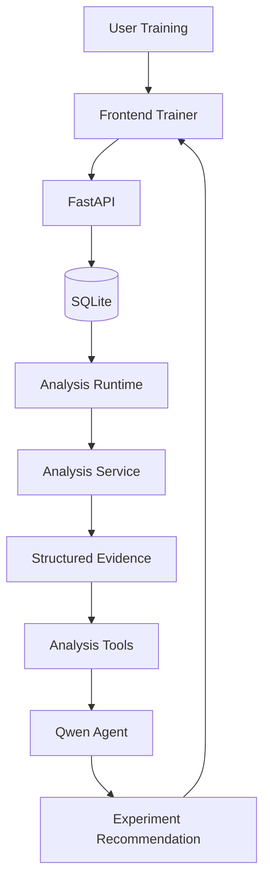

# AI Aim Coach

AI Aim Coach 是一个基于真实训练数据的个性化瞄准训练系统。

当前 MVP 聚焦：

> **Flick Sensitivity Test**

它不是一个完整的 Aim Trainer，也不是简单地给训练器接一个聊天机器人。

项目的核心目标，是建立一条完整、可验证的数据与 AI 决策链路：

```text
Aim Training
→ Raw Mouse Data
→ Deterministic Analysis
→ Structured Evidence
→ Analysis Tools
→ LLM Agent
→ Next Experiment Recommendation
```

## Why This Project

传统 Aim Trainer 通常更关注最终分数，而 AI Aim Coach 更关注训练过程本身。

当前系统会采集：

- 鼠标完整移动轨迹
- Target 位置
- Cursor 起点
- Click 位置
- HIT / MISS
- Target Timing
- Trainer Sensitivity
- Session / Experiment 信息

这些 Raw Data 会先经过确定性分析，转换为可解释的训练指标。

LLM 不直接分析原始鼠标轨迹，而是通过 Analysis Tools 使用已经计算好的 Evidence，并根据用户目标规划下一轮实验。

核心原则：

> **Real Data > AI Guess**

> **Deterministic Analysis determines what is true.**

> **Agent decides what to do next.**

## Current System



```text
Physical Mouse
      ↓
Pointer Lock
      ↓
raw movementX / movementY
      ↓
Trainer Sensitivity
      ↓
Virtual Crosshair
      ↓
Target / Attempt / Session
      ↓
FastAPI
      ↓
SQLite
      ↓
Analysis Runtime
      ↓
Deterministic Analysis Service
      ↓
Structured Evidence
      ↓
Analysis Tools
      ↓
Qwen Tool-Calling Agent
      ↓
Experiment Recommendation
      ↓
Frontend
```

## Current Features

### 1. Browser Aim Trainer

当前 Trainer 支持：

- Pointer Lock
- Raw mouse movement
- Virtual Crosshair
- Random Target
- HIT / MISS
- Multi-target Session
- Trainer Sensitivity
- Experiment Schedule

为了尽量降低操作系统鼠标加速度对输入的影响，Trainer 优先请求：

```javascript
requestPointerLock({
    unadjustedMovement: true
})
```

如果浏览器不支持，则回退到普通 Pointer Lock。

### 2. Raw Training Data Collection

每一个 Attempt 保存：

```text
Target
├── position
├── radius
├── appearTime
├── disappearTime
├── cursorStartX
└── cursorStartY

Movements[]
├── time
├── rawDX
├── rawDY
├── x
└── y

Clicks[]
├── time
├── x
├── y
└── hit
```

多个 Attempt 组成一个 Session。

Session 同时记录：

- `sessionId`
- `experimentId`
- `trainerSensitivity`
- `targetCount`
- `experimentOrder`
- `sensitivityRepeat`
- Trainer Size
- `attempts[]`

Raw Data 只保存事实，不直接保存分析结论。

### 3. SQLite Persistence

完成的 Training Session 会通过：

```http
POST /sessions
```

发送给 FastAPI，并持久化到 SQLite。

当前数据库设计采用：

```text
常查询 Metadata
→ SQLite Columns

完整细粒度训练数据
→ Raw JSON
```

这样可以在保留查询能力的同时，避免过早将 `attempts / movements / clicks` 拆成大量关系表。

如果 Backend 保存失败，Trainer 会回退到本地 JSON 下载，避免真实训练数据丢失。

### 4. Deterministic Sensitivity Analysis

当前 Sensitivity Analysis 使用四个基础指标。

#### Final Hit Time

Target 出现到最终成功 HIT 的时间。

#### Miss Count

Attempt 中成功 HIT 前发生的 MISS 数量。

#### First-click Error

第一次 Click 到 Target Center 的欧氏距离。

#### Path Efficiency

```text
cursor start → final HIT position 的直线距离
/
真实 Cursor 移动路径长度
```

用于描述移动路径的直接程度。

分析同时保留：

- Mean
- Median
- Standard Deviation
- Sample Count
- Session-level Summary
- Miss Attempt Rate

### 5. Experiment Evidence

正式 Sensitivity Experiment：

```text
Sensitivity:
0.8 / 1.0 / 1.2

3 Sessions per sensitivity
20 Attempts per Session

Total:
9 Sessions
180 Attempts
```

实验顺序随机化，以降低固定的学习 / 疲劳顺序影响。

当前最稳定的 Deterministic Finding：

> Sensitivity 1.2 的 Path Efficiency 在 3/3 个独立 Session 中均低于 0.8 / 1.0 的所有 Session Median。

同时，没有观察到 1.2 稳定的 Final Hit Time 优势。

Analyzer 不直接输出“最佳 Sensitivity”。

它只输出 Evidence。

## Analysis Architecture

Analysis Layer 被设计成纯计算能力：

```text
sessions: list[dict]
        ↓
analyze_sessions()
        ↓
Structured Analysis Result
```

Analysis Service 不依赖：

- SQLite
- FastAPI
- 文件系统
- LLM

Storage Layer 负责：

```text
experiment_id
→ sessions
```

Analysis Layer 负责：

```text
sessions
→ metrics
→ profiles
→ deterministic findings
```

Analysis Runtime 负责把 Storage 与 Analysis 连接起来。

## Analysis Tools

当前 Agent 可以使用三个确定性 Tool：

```text
get_analysis_summary()

get_sensitivity_profile(sensitivity)

compare_sensitivities(sensitivities)
```

Tool 不直接读取 Raw Mouse Events。

Tool 负责向 Agent 暴露稳定的 Structured Evidence。

## Agent Runtime

项目使用 Qwen API 实现显式 Tool Calling Loop：

```text
User Goal
↓
Qwen
↓
Tool Call
↓
Python Dispatcher
↓
Analysis Tool
↓
Structured Evidence
↓
Qwen
↓
Next Tool / Final Answer
```

LLM 不直接执行 Python。

真正的 Tool Execution 始终由 Application Runtime 控制。

真实 Runtime 中，Agent 曾自主执行：

```text
get_analysis_summary
↓
compare_sensitivities
↓
get_sensitivity_profile
↓
Final Recommendation
```

Tool 顺序不是固定 Workflow，而是根据当前 User Goal 和 Evidence 动态选择。

## Backend API

当前主要接口：

### Save Training Session

```http
POST /sessions
```

负责保存完整 Raw Training Session。

### Get Session

```http
GET /sessions/{session_id}
```

用于读取已经持久化的 Session。

### Generate Experiment Plan

```http
POST /agent/plan
```

Request：

```json
{
  "goal": "我想提高 Flick 速度，但不希望明显牺牲稳定性。",
  "experiment_id": "<GET /experiments/current 返回的 ID>"
}
```

Response：

```json
{
  "goal": "...",
  "status": "ok",
  "request_id": "...",
  "trace": [],
  "usage": {},
  "evidence": {"experiment_id": "...", "snapshot_id": "...", "incomplete": true},
  "answer": "...",
  "tools_used": [
    "get_analysis_summary",
    "compare_sensitivities"
  ]
}
```

`tools_used` 提供最小 Agent Observability。

## Project Structure

```text
AimCoach/
├── frontend/
│   ├── index.html
│   ├── style.css
│   └── trainer.js
├── backend/
│   ├── __init__.py
│   ├── main.py
│   └── session_store.py
├── analysis/
│   ├── __init__.py
│   ├── analysis_service.py
│   ├── analysis_runtime.py
│   ├── session_validator.py
│   └── tools.py
├── agent/
│   ├── __init__.py
│   └── experiment_planner.py
├── data/
│   └── aimcoach.db
├── ENGINEERING_EVIDENCE.md
├── requirements.txt
├── .gitignore
├── run.ps1
└── README.md
```

## P0 Reliability Workflow

默认没有 `DASHSCOPE_API_KEY` 也可启动训练、Session 保存/查询和确定性分析；只有 Agent 推荐需要配置模型。缺 Key 返回明确的 503，不生成模拟建议。

新 Demo 实验为三档 sensitivity × 三次重复 × 每 Session 3 个目标；下文 9×20 的正式实验描述是历史证据，不能混为当前协议。实验由后端创建并恢复，Agent 请求必须带 `experiment_id`。

离线检查（FastAPI/Pydantic 环境、Python 3.12 和 Node 22；不需要 Key/真实数据库）：

```powershell
python -B scripts/run_checks.py
```

`requirements-runtime.txt` 安装最小本地服务；`requirements-agent.txt` 额外安装现有 OpenAI SDK；`requirements-test.txt` 用于离线测试。三者共享 `requirements-lock.txt` 的依赖约束。原 `requirements.txt` 保留为历史环境清单。CI 配置使用同一检查命令，远程 CI 尚未运行。

明确标注为合成数据的独立 Demo 库（禁止使用原训练数据库路径）：

```powershell
python -B scripts/seed_demo.py --db "$env:TEMP/aimcoach-synthetic-demo.db"
$env:AIMCOACH_DB_PATH = "$env:TEMP/aimcoach-synthetic-demo.db"
.\run.ps1
```

seed 可重复执行；若目标包含非 Demo 数据会拒绝，不覆盖、不迁移真实记录。历史 JSON adapter 仅用于只读 fixture 验证，来源 hash 见 tests/fixtures/legacy_manifest.json。

已保存 Session 的确定性分析：`GET /experiments/{experiment_id}/analysis`。Agent 响应附 status、request_id、trace 和 evidence；失败响应附安全错误码及 request ID。保存中的数据进入持久待上传队列，可重试或手动导出；相同 Session ID/内容重试不会重复写入。

P0 历史交付记录见 [P0 completion report](docs/engineering-review/P0_COMPLETION_REPORT.md)。本轮最新核销见 [Engineering completion report](docs/engineering-review/ENGINEERING_COMPLETION_REPORT.md)，启动和备份见 [Local operations](docs/engineering-review/LOCAL_OPERATIONS.md)，人工操作见 [Acceptance checklist](docs/engineering-review/USER_ACCEPTANCE_CHECKLIST.md)。

## Run Locally

### Home / Test Demo

运行下文启动命令后，打开 `http://127.0.0.1:8000/` 或 `/#/home` 查看首页；导航或 Start Training 进入 `/#/test`。Hash 路径可直接刷新，不需要前端构建工具或 npm install。前端使用原生 ES Modules，请通过 HTTP 服务访问，不要直接打开 HTML 文件。

Home 首次载入不创建实验；首次进入 Test 后恢复状态和 pending 队列，切页复用同一控制器。训练区仍是完整 `100vw × 100vh`，开始时滚动对齐视口；AI Insights 为覆盖式 Drawer，不缩放训练区。训练中先按 Esc 再切页或打开面板。打开面板只查询确定性分析，点击生成才请求模型。

完整设计、模块图、回归及人工验收见 [Frontend redesign report](docs/frontend/FRONTEND_REDESIGN_REPORT.md)。统一测试仍为 `python -B scripts/run_checks.py`；直接运行 Node 测试需加 `--experimental-vm-modules`，用于加载真实 ES Modules，浏览器运行不需要此标志。

### 1. Create / Activate Environment

```powershell
conda create -n aimcoach python=3.12
conda activate aimcoach
```

Install dependencies:

```powershell
python -m pip install -r requirements-runtime.txt
# Optional Agent capability:
python -m pip install -r requirements-agent.txt
```

### 2. Configure Qwen API Key (optional for training / deterministic analysis)

```powershell
conda env config vars set DASHSCOPE_API_KEY="your-api-key"
```

Reactivate the environment:

```powershell
conda deactivate
conda activate aimcoach
```

Verify:

```powershell
[bool]$env:DASHSCOPE_API_KEY
```

### 3. Start AI Aim Coach

```powershell
.\run.ps1
```

Open:

```text
http://127.0.0.1:8000
```

FastAPI Swagger:

```text
http://127.0.0.1:8000/docs
```

## Engineering Decisions

### Raw Data Before AI

LLM does not interpret raw mouse trajectories directly.

Deterministic analysis first converts Raw Data into explainable Evidence.

### SQLite Before PostgreSQL

Current application is local, single-user and low-concurrency.

SQLite satisfies the real persistence requirement without introducing unnecessary infrastructure.

### No Agent Framework

The current Agent Loop is implemented explicitly using model Tool Calling.

This keeps Tool execution, state, error handling and guardrails visible and understandable.

### No Premature Machine Learning

The current system uses explainable deterministic metrics before considering ML-based performance modeling.

## Current Limitations

Current MVP is intentionally limited:

- Single-user local application
- Descriptive statistics only
- No statistical significance testing
- Experimental evidence currently comes from one player / environment
- No production user account system
- No multi-device state synchronization
- Agent may require multiple sequential model calls and therefore has noticeable latency
- Client event consistency is validated; self-reported data cannot prove authentic physical hits
- No public deployment yet

## Project Status

```text
Raw Data Acquisition MVP              PASS
Sensitivity Analysis v0.1             PASS
Structured Analysis Result            PASS
Analysis Tools                        PASS
Multi-tool Agent Runtime              PASS
FastAPI Agent Integration             PASS
SQLite Session Persistence            PASS
Database Session Source               PASS
Frontend / Backend Integration        PASS
Application Packaging v0.1            PASS
```

Current focus:

> **Demo Quality → Engineering Evidence → Deployment → Interview Readiness**

## Engineering Evidence

For detailed runtime failures, design decisions, validation history and engineering evidence, see:

```text
ENGINEERING_EVIDENCE.md
```


## Phase 1 Settings & Persistence

Test 页面齿轮设置用于下一次新实验；当前实验配置冻结不变。P 暂停/继续（当前未完成 Attempt 重做），E 提前结束 Session；未完成记录单独归档。结束实验保留历史，随后可创建新配置实验。首次重启会新增两张归档/结束元数据表，不清空原表。

完整默认值、API、备份回滚和人工验收见 [Phase 1 report](docs/phase1/PHASE1_REPORT.md)。请重启后端后通过 HTTP 刷新页面。真实持久化检查：`node --experimental-vm-modules scripts/check_phase1_persistence.cjs`，默认使用本机 aimcoach Python；其他环境可设置 `AIMCOACH_TEST_PYTHON` 为当前 Python 可执行路径。该检查模拟 DOM 输入，实际运行前端 ESM、HTTP 和临时 SQLite，不是物理鼠标 E2E。


## Phase 2 Scenario Library & Scoring

Test 页 Scenario Library 提供四目标切换、六目标精准、水平/垂直跟随、随机 Flick、动态反应跟随。未结束的旧实验必须先显式结束（历史保留），再点“开始场景”。新场景使用普通页面指针，P 暂停/继续、E 或 Escape 提前结束；原 Flick 仍使用原 Pointer Lock 流程。每个新场景实验包含一个 Session，配置和 `aim-score-1` 评分权重冻结到协议及 Session。

综合分由 Python 根据原始点击或最多 20Hz 跟随样本重算，浏览器提交的成绩不被采用；这些数据仍属于客户端报告，不是防作弊证据。历史对比仅使用完全同配置、同 viewport、同评分版本的完成成绩。首次使用新后端将新增 `scenario_sessions` 表，不修改旧训练记录。

重启后端并通过 HTTP 刷新页面。完整定义、公式、实际测试结果和验收步骤见 [Phase 2 report](docs/phase2/PHASE2_REPORT.md)。离线回归：`python -B scripts/run_checks.py`；六场景真实 HTTP + 临时 SQLite + 重启检查：`node --experimental-vm-modules scripts/check_phase2_persistence.cjs`（可设置 `AIMCOACH_TEST_PYTHON`）。

## Phase 3 Personalized Training

Test 页 Personalized Training Plan 通过原 Tool Calling Runtime 查询有界历史、按同条件分析趋势并生成受约束计划。先设置目标、时长/数量/难度边界及可选日期范围，点击请求后审阅计划；接受只创建并关联 Experiment，仍需手动点击场景库开始训练。可以拒绝或重新推荐，旧建议和证据保留。运行使用原有模型配置；无可用模型时返回明确错误，不自动伪造模型回复。请求模型可能消耗配置账号的额度，请按需操作。

所有趋势、参数选择和训练效果评估由 Python 确定性计算；模型输出必须原样引用已验证工具计划。新建 `training_plans` 元数据表，旧评分定义与历史训练记录不变。效果评估至少需要3条推荐前、2条执行后的同条件有效数据；变化不构成因果证明。历史请求先按日期/场景限定范围，再最多读取100条，工具单次最多返回50条，旧 Flick 指标可查询但不与场景成绩混合比较。

运行 `python -B scripts/run_checks.py` 进行离线回归；`python -B scripts/check_phase3_training.py` 使用明确标识的 Fake Client、合成数据、临时 SQLite 和真实本地 HTTP 验证计划/执行/评估/重启流程，不调用真实模型。详见 [Phase 3 report](docs/phase3/PHASE3_REPORT.md) 与 [合成测试完整示例](docs/phase3/demo-example.json)。

## Phase 4 Workspace & Focus Mode

入口：`http://127.0.0.1:8012/#/hub`。Training Hub 选择任务和查看最近/同条件最佳；Aim Arena (`#/arena`，兼容 `#/test`) 负责实际训练；AI Coach (`#/coach`) 审阅、确认和评估计划；History (`#/history`) 提供真实历史、同条件图表和 Session 详情。

Arena 采用固定64px HUD + 剩余坐标区域 + 64px控制栏，在桌面视口下不靠裁切页面消除滚动。进入 ACTIVE 后只保留任务/进度/计时、准心目标、暂停和退出；暂停、结束、Summary 都不改变坐标区域尺寸。P / Esc 暂停，E 进入退出确认；失焦暂停计时与采样，resize 归档未完成。Settings 作为内部可滚动 Drawer，仅保存下一实验偏好。自由场景现在会冻结这些视觉偏好；任务数量与时长仍由场景或已接受计划决定。

首次加载新布局时，旧活动实验的冻结尺寸可能不同。请在 Hub 明确结束旧实验（历史保留），再创建新训练；不会缩放旧证据或重写已有成绩。历史图表按完整 condition key、难度、评分版本和 viewport 分组，不进行跨条件排名。没有足够数据时显示 Empty State 或样本不足。

完整交付、浏览器测量和限制见 [Phase 4 report](docs/phase4/PHASE4_REPORT.md)；人工验收见 [Final acceptance checklist](docs/phase4/USER_ACCEPTANCE_CHECKLIST.md)。备份位于 `data/backups/`，已从 Git 排除。真实模型请求仍由用户主动触发；本轮测试只使用 Fake Client。
