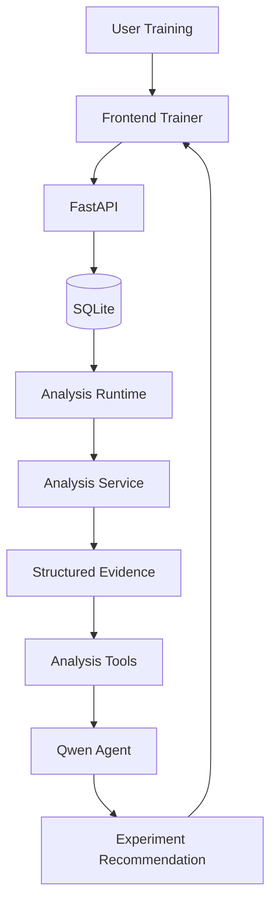

# AI Aim Coach

AI Aim Coach 是一个基于真实训练数据的个性化瞄准训练系统。

当前 MVP 聚焦：

> **Flick Sensitivity Test**

它不是一个完整的 Aim Trainer，也不是简单地给训练器接一个聊天机器人。

项目的核心目标，是建立一条完整、可验证的数据与 AI 决策链路：

```text
Aim Training
→ Raw Mouse Data
→ Deterministic Analysis
→ Structured Evidence
→ Analysis Tools
→ LLM Agent
→ Next Experiment Recommendation
```

## Why This Project

传统 Aim Trainer 通常更关注最终分数，而 AI Aim Coach 更关注训练过程本身。

当前系统会采集：

- 鼠标完整移动轨迹
- Target 位置
- Cursor 起点
- Click 位置
- HIT / MISS
- Target Timing
- Trainer Sensitivity
- Session / Experiment 信息

这些 Raw Data 会先经过确定性分析，转换为可解释的训练指标。

LLM 不直接分析原始鼠标轨迹，而是通过 Analysis Tools 使用已经计算好的 Evidence，并根据用户目标规划下一轮实验。

核心原则：

> **Real Data > AI Guess**

> **Deterministic Analysis determines what is true.**

> **Agent decides what to do next.**

## Current System



```text
Physical Mouse
      ↓
Pointer Lock
      ↓
raw movementX / movementY
      ↓
Trainer Sensitivity
      ↓
Virtual Crosshair
      ↓
Target / Attempt / Session
      ↓
FastAPI
      ↓
SQLite
      ↓
Analysis Runtime
      ↓
Deterministic Analysis Service
      ↓
Structured Evidence
      ↓
Analysis Tools
      ↓
Qwen Tool-Calling Agent
      ↓
Experiment Recommendation
      ↓
Frontend
```

## Current Features

### 1. Browser Aim Trainer

当前 Trainer 支持：

- Pointer Lock
- Raw mouse movement
- Virtual Crosshair
- Random Target
- HIT / MISS
- Multi-target Session
- Trainer Sensitivity
- Experiment Schedule

为了尽量降低操作系统鼠标加速度对输入的影响，Trainer 优先请求：

```javascript
requestPointerLock({
    unadjustedMovement: true
})
```

如果浏览器不支持，则回退到普通 Pointer Lock。

### 2. Raw Training Data Collection

每一个 Attempt 保存：

```text
Target
├── position
├── radius
├── appearTime
├── disappearTime
├── cursorStartX
└── cursorStartY

Movements[]
├── time
├── rawDX
├── rawDY
├── x
└── y

Clicks[]
├── time
├── x
├── y
└── hit
```

多个 Attempt 组成一个 Session。

Session 同时记录：

- `sessionId`
- `experimentId`
- `trainerSensitivity`
- `targetCount`
- `experimentOrder`
- `sensitivityRepeat`
- Trainer Size
- `attempts[]`

Raw Data 只保存事实，不直接保存分析结论。

### 3. SQLite Persistence

完成的 Training Session 会通过：

```http
POST /sessions
```

发送给 FastAPI，并持久化到 SQLite。

当前数据库设计采用：

```text
常查询 Metadata
→ SQLite Columns

完整细粒度训练数据
→ Raw JSON
```

这样可以在保留查询能力的同时，避免过早将 `attempts / movements / clicks` 拆成大量关系表。

如果 Backend 保存失败，Trainer 会回退到本地 JSON 下载，避免真实训练数据丢失。

### 4. Deterministic Sensitivity Analysis

当前 Sensitivity Analysis 使用四个基础指标。

#### Final Hit Time

Target 出现到最终成功 HIT 的时间。

#### Miss Count

Attempt 中成功 HIT 前发生的 MISS 数量。

#### First-click Error

第一次 Click 到 Target Center 的欧氏距离。

#### Path Efficiency

```text
cursor start → final HIT position 的直线距离
/
真实 Cursor 移动路径长度
```

用于描述移动路径的直接程度。

分析同时保留：

- Mean
- Median
- Standard Deviation
- Sample Count
- Session-level Summary
- Miss Attempt Rate

### 5. Experiment Evidence

正式 Sensitivity Experiment：

```text
Sensitivity:
0.8 / 1.0 / 1.2

3 Sessions per sensitivity
20 Attempts per Session

Total:
9 Sessions
180 Attempts
```

实验顺序随机化，以降低固定的学习 / 疲劳顺序影响。

当前最稳定的 Deterministic Finding：

> Sensitivity 1.2 的 Path Efficiency 在 3/3 个独立 Session 中均低于 0.8 / 1.0 的所有 Session Median。

同时，没有观察到 1.2 稳定的 Final Hit Time 优势。

Analyzer 不直接输出“最佳 Sensitivity”。

它只输出 Evidence。

## Analysis Architecture

Analysis Layer 被设计成纯计算能力：

```text
sessions: list[dict]
        ↓
analyze_sessions()
        ↓
Structured Analysis Result
```

Analysis Service 不依赖：

- SQLite
- FastAPI
- 文件系统
- LLM

Storage Layer 负责：

```text
experiment_id
→ sessions
```

Analysis Layer 负责：

```text
sessions
→ metrics
→ profiles
→ deterministic findings
```

Analysis Runtime 负责把 Storage 与 Analysis 连接起来。

## Analysis Tools

当前 Agent 可以使用三个确定性 Tool：

```text
get_analysis_summary()

get_sensitivity_profile(sensitivity)

compare_sensitivities(sensitivities)
```

Tool 不直接读取 Raw Mouse Events。

Tool 负责向 Agent 暴露稳定的 Structured Evidence。

## Agent Runtime

项目使用 Qwen API 实现显式 Tool Calling Loop：

```text
User Goal
↓
Qwen
↓
Tool Call
↓
Python Dispatcher
↓
Analysis Tool
↓
Structured Evidence
↓
Qwen
↓
Next Tool / Final Answer
```

LLM 不直接执行 Python。

真正的 Tool Execution 始终由 Application Runtime 控制。

真实 Runtime 中，Agent 曾自主执行：

```text
get_analysis_summary
↓
compare_sensitivities
↓
get_sensitivity_profile
↓
Final Recommendation
```

Tool 顺序不是固定 Workflow，而是根据当前 User Goal 和 Evidence 动态选择。

## Backend API

当前主要接口：

### Save Training Session

```http
POST /sessions
```

负责保存完整 Raw Training Session。

### Get Session

```http
GET /sessions/{session_id}
```

用于读取已经持久化的 Session。

### Generate Experiment Plan

```http
POST /agent/plan
```

Request：

```json
{
  "goal": "我想提高 Flick 速度，但不希望明显牺牲稳定性。"
}
```

Response：

```json
{
  "goal": "...",
  "answer": "...",
  "tools_used": [
    "get_analysis_summary",
    "compare_sensitivities"
  ]
}
```

`tools_used` 提供最小 Agent Observability。

## Project Structure

```text
AimCoach/
├── frontend/
│   ├── index.html
│   ├── style.css
│   └── trainer.js
├── backend/
│   ├── __init__.py
│   ├── main.py
│   └── session_store.py
├── analysis/
│   ├── __init__.py
│   ├── analysis_service.py
│   ├── analysis_runtime.py
│   ├── session_validator.py
│   └── tools.py
├── agent/
│   ├── __init__.py
│   └── experiment_planner.py
├── data/
│   └── aimcoach.db
├── ENGINEERING_EVIDENCE.md
├── requirements.txt
├── .gitignore
├── run.ps1
└── README.md
```

## Run Locally

### 1. Create / Activate Environment

```powershell
conda create -n aimcoach python=3.12
conda activate aimcoach
```

Install dependencies:

```powershell
pip install -r requirements.txt
```

### 2. Configure Qwen API Key

```powershell
conda env config vars set DASHSCOPE_API_KEY="your-api-key"
```

Reactivate the environment:

```powershell
conda deactivate
conda activate aimcoach
```

Verify:

```powershell
echo $env:DASHSCOPE_API_KEY
```

### 3. Start AI Aim Coach

```powershell
.\run.ps1
```

Open:

```text
http://127.0.0.1:8000
```

FastAPI Swagger:

```text
http://127.0.0.1:8000/docs
```

## Engineering Decisions

### Raw Data Before AI

LLM does not interpret raw mouse trajectories directly.

Deterministic analysis first converts Raw Data into explainable Evidence.

### SQLite Before PostgreSQL

Current application is local, single-user and low-concurrency.

SQLite satisfies the real persistence requirement without introducing unnecessary infrastructure.

### No Agent Framework

The current Agent Loop is implemented explicitly using model Tool Calling.

This keeps Tool execution, state, error handling and guardrails visible and understandable.

### No Premature Machine Learning

The current system uses explainable deterministic metrics before considering ML-based performance modeling.

## Current Limitations

Current MVP is intentionally limited:

- Single-user local application
- Descriptive statistics only
- No statistical significance testing
- Experimental evidence currently comes from one player / environment
- No production user account system
- No multi-device state synchronization
- Agent may require multiple sequential model calls and therefore has noticeable latency
- Session Integrity Validator is implemented but not yet part of a complete validation test suite
- No public deployment yet

## Project Status

```text
Raw Data Acquisition MVP              PASS
Sensitivity Analysis v0.1             PASS
Structured Analysis Result            PASS
Analysis Tools                        PASS
Multi-tool Agent Runtime              PASS
FastAPI Agent Integration             PASS
SQLite Session Persistence            PASS
Database Session Source               PASS
Frontend / Backend Integration        PASS
Application Packaging v0.1            PASS
```

Current focus:

> **Demo Quality → Engineering Evidence → Deployment → Interview Readiness**

## Engineering Evidence

For detailed runtime failures, design decisions, validation history and engineering evidence, see:

```text
ENGINEERING_EVIDENCE.md
```
