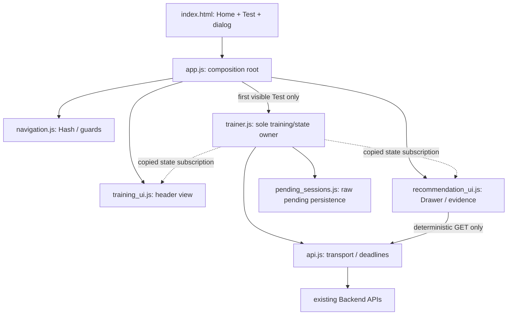

# Frontend Redesign & Controlled Refactoring

日期：2026-10-28。HTML/CSS/Vanilla JavaScript + ES Modules，无框架、动画库、构建工具或新增外部服务。

本轮完成 Home、Home/Test Hash 导航、Test 展示层、右侧 AI Insights Drawer 和受控模块化。核心训练/实验/保存仍由一个控制器负责；Backend、Analysis、Agent Runtime、真实数据库及历史工程报告没有修改。未 commit/push。

## 1. 页面与视觉设计

### Home：展示封面

默认 `/` 或 `/#/home`：顶部导航、产品定位、Start Training、装饰性 SVG 瞄准环/示意路径、三张现有能力卡片与本地 Demo 定位。封面图明确标注 illustration，不是训练数据、成绩或轨迹回放。

Home 首次加载不导入训练控制器，不请求实验 API、不创建 Session；点击 Test/CTA 后才初始化。若在已经初始化的 Test 中保存尚未结束，切回 Home 不销毁控制器或中断保存。硬刷新 Home 时，pending 保留，进入 Test 后执行原有恢复/重试流程。

### Test：真实训练工作区

`/#/test`：训练标题、服务端实验 ID、已确认 Session 进度、下一条件、状态徽标、完整训练表面、保存反馈/重试/导出。已有 DOM ID 和按钮语义保留。

**训练区仍然是原来的 `100vw × 100vh`**，没有使用较小卡片高度、缩放或重新定义坐标。新增导航和状态栏位于表面外。开始锁定鼠标前，以及锁定后恢复完成时，将训练区瞬时滚动对齐视口，避免页面头部使部分目标不可见。表面没有新增动画、padding、border 或 ancestor transform；边框效果使用不占尺寸的 inset shadow。

返回 Home 的操作在采集中、已锁定或锁定申请期间会被阻止，并提示先按 Esc。初始化恢复期间也阻止切页，防止隐藏区域以零尺寸创建协议。Esc 仍使用原来的未完成 Session 中止语义，没有新增暂停/恢复。

### AI Insights：覆盖式 Drawer

使用原生 `<dialog>.showModal()`：固定在右侧，桌面最大 580px，小窗口限制为可视宽度；背景 inert 和基础焦点约束由浏览器提供。支持关闭按钮、Escape、背景区域点击，关闭后恢复焦点且不额外滚动页面。打开时轻量 slide-in；不参与训练布局。

- Overview：当前实验与建议来源范围。
- Recommendation：原有目标输入、显式生成/取消、原始自然语言正文、实际工具名。没有将自由文本擅自解释为结构化计划。
- Evidence：调用已有确定性 Analysis API，按 sensitivity 展示 **pooled Attempt median** 的四项原指标、Session/Attempt 数、完整 snapshot_id 和不完整标记。不是跨 Session 显著性结论；缺值显示 `—`。
- Limitations：展示 Analysis 实际返回的 message；后续建议仍保留在 Agent 原文，不自动创建训练任务。
- 状态：无证据、待读取/生成中、成功、失败；缺 Key 明确失败，不替换成模拟建议。

打开/重开 Drawer **不会请求模型**。有已保存数据时仅 GET `/experiments/{id}/analysis`；点击生成才 POST `/agent/plan`。请求关闭后返回、或实验 Session 集合变更时，旧分析不展示。分析和建议 snapshot 不同会显式标注，不能把独立查询结果冒充该建议的引用依据。

### Design tokens 与动效

背景深蓝黑、分层深色 surface、电青色主强调、低占比紫蓝色 token，配合明确的 warning/error 色。系统字体搭配 monospace 元数据；统一按钮、圆角、边框、留白、导航激活与 focus-visible。

Home 有渐入和轻量目标脉冲，按钮/卡片有克制 hover，Drawer 展开和模型 loading 有 CSS 动画。`prefers-reduced-motion: reduce` 关闭动画和 transition。训练目标仍保持原 50px 红色圆及 16px 白色虚拟准星，避免展示动画改变目标观感或输入时序。

## 2. 文件清单与原有工作归属

修改：

- `frontend/index.html`：两页 shell、原有训练节点、原生 Drawer、单一 module 入口及可访问标签。
- `frontend/style.css`：主题 tokens、Home/Test/Drawer、响应式和 reduced-motion；坐标表面保留旧尺寸。
- `frontend/trainer.js`：ESM imports、只读状态接口、UI 订阅通知、页面/锁定保护和建议来源元数据；保留高风险业务控制逻辑。
- `frontend/pending_sessions.js`：原类改为 ESM export，去除 CommonJS 尾部；队列方法、key、版本和幂等 ACK 逻辑保留。
- `tests/test_experiment_frontend.cjs`：真实 ESM 加载、原行为断言保留，新增 Pointer Lock/只读视图保护；跨页证据失效反馈增加断言。
- `tests/test_pending_queue.cjs`：改为动态 import 真实 ESM，保留原四项断言。
- `scripts/run_checks.py`：Node 测试增加 VM Modules 标志、新 shell 测试；语法检查覆盖全部七个 JS 模块。
- `README.md`：新增 Home/Test 地址、启动与模块测试说明、报告链接。

新增：

- `frontend/package.json`：仅声明 private + type=module，不需要 npm install。
- `frontend/app.js`：页面组合根、首次进入 Test 的单次初始化。
- `frontend/navigation.js`：Hash 导航、初始化/训练中的切页保护、销毁时解绑。
- `frontend/api.js`：请求超时、取消、JSON 解析、安全错误映射；补充安全 error.code 给展示层区分状态。
- `frontend/training_ui.js`：只读状态 → header、进度、条件、入口提示。
- `frontend/recommendation_ui.js`：Drawer、焦点、确定性证据展示和独立请求生命周期。
- `tests/esm_loader.cjs`：隔离 VM 中加载真实 module graph。
- `tests/test_frontend_shell.cjs`：8 项新导航/Drawer/模块生命周期回归。
- 本报告及 `docs/frontend/artifacts/` 下的日志、只读比对记录和浏览器截图。

开始时已有大量 P0/P1 未提交内容；本轮没有将这些计为新成果。没有修改 backend、agent、analysis、原数据库、原 fixtures、依赖锁、原工程审计与 Code Review 报告。普通 `git diff HEAD` 会混入之前未提交的实现，审查时以本节清单和下文 Before/After 为本轮边界。

## 3. 模块职责与数据流

Before：两个 classic script 通过全局 PendingSessionQueue 连接；trainer.js 同时承担网络、实验控制、训练和页面展示。没有导航层与 Drawer。

After：



没有循环依赖、全局 store 或多个模块共同修改核心状态。app 的动态 import promise 只创建一次；页面切换只设置 hidden，不重挂事件监听。Core 导出的 `ready` 让 shell 等待第一次恢复完成。`getTrainingState()` 复制 protocol/progress/evidence，展示层不能通过引用修改实验。订阅异常被隔离，不能打断原始采集或保存。

保存数据流仍是：完成原始 Session → pendingQueue.put → POST → 正确 Session ID 的服务端 ACK → acknowledge → GET experiment → 更新已确认进度。Home/Test 切换不清队列；无需重新生成 schedule 或重新创建 ID。

Agent 数据流仍在原控制器中：显式 goal/id 请求 → 等待既有 runtime → 校验版本/实验及已提交 Session 集合 → 显示原答复。新增 UI 只读取 `recommendationEvidence`。开始采集、保存或跨页通知失效时，旧正文隐藏，状态文字也不继续引用旧快照。

### 为什么保留长控制器

本轮没有机械拆开 startSession/spawnTarget/事件采集、恢复协议、pending flush 或 Agent 请求互斥。它们共享经过验证的生命周期，贸然迁移会扩大回归面。原始保存反馈和 Agent DOM 更新仍在 controller 内；这意味着 trainer.js 依然较长，属于有意保留的技术债，而不是已完全分层的声明。

已经独立的是可复用网络、持久队列、导航、header 和新增 Drawer 展示。未来只有在具体修改需要时再拆领域控制逻辑，本轮不引入新框架。

## 4. 关键 Before / After

### 脚本与模块加载

```html
<!-- Before: global queue + immediately initialized trainer -->
<script src="pending_sessions.js"></script>
<script src="trainer.js"></script>

<!-- After: one ESM composition root -->
<script type="module" src="./app.js?v=frontend-redesign-1"></script>
```

```javascript
// Only after the Test page is visible:
trainerPromise ||= import("./trainer.js").then(async module => {
    await module.ready;
    // Bind read-only views once.
});
```

### 网络层

Before：readExperimentResponse/fetchJson 整段位于 trainer.js。

After：`requestJson()` 位于 api.js，保留原 timeout、外部 AbortSignal、body parsing deadline、retryable 标记和 request ID 文案；控制器仍决定 15s/70s 的等待预算及重试策略。没有将重试或实验状态放到 transport。

### 状态与页面边界

Before：DOM 显示与训练状态在同一文件；没有页面隐藏场景。

After：

```javascript
export function canLeaveTrainingPage() {
    return !sessionActive && !pointerLockPending
        && document.pointerLockElement !== trainerArea;
}
```

`pointerLockPending` 保护申请到锁定事件之间的空档；`stateListeners` 只传复制快照；`trainerPromise` 保护初始化次数。窗口尺寸和原协议不匹配仍在原入口拒绝，不通过改指标或改数据库来适配 UI。

### Pointer Lock 失败与迟到事件

真实 IAB 检查暴露：有的失败请求会产生 pointerlockerror，却没有及时 settle Promise。新增 pending guard 若只等 finally，会使导航永久阻塞。

After：失败事件释放 pending；若离开 Test 后才锁定，pointerlockchange 检查隐藏祖先并立即退出，不开始采集。浏览器复测已能在失败后返回 Home，Node 用例覆盖 pending/error 和隐藏页面迟到锁定。没有将失败变成成功，也没有绕过浏览器限制。

### 证据展示

Before：只有 Agent 正文、工具名和状态字符串。

After：Drawer 额外读取现有 Analysis API 中的 `profile.metrics[key].median` 和 evidence；数字来源保持明确。曾在实现检查中确认真实字段名为 metrics，未使用不存在的 pooled_attempt_metrics；回归直接核对四个展示值。正文依然使用 textContent，未解析为 HTML 或结构化业务指令。

## 5. 保持不变的业务逻辑

除自动回归外，使用本轮开始前的前端副本做只读逐段比较。以下 **11 处原文相同**，结果见 artifacts/preservation-check.json：

- clamp、renderCrosshair、spawnTarget、isTargetHit。
- downloadSessionAsJson、saveSessionToBackend、completeCurrentAttempt。
- retryPendingSessions、completeSession。
- mousemove、mousedown 事件处理体（主按钮规则也保留）。

startSession 的原数据结构保留，仅新增展示通知；Pointer Lock 周边增加导航保护和视口对齐。PendingSessionQueue 仅转换 export 形式，原四项队列回归保留。

Backend API、四指标、finding、AnalysisSnapshot、Agent Runtime 完全未动；Python 历史黄金/来源校验通过。真实训练库 SHA256 前后均为：

`1c4a46be675fba110ee79e66aa3a01fd6fc7276401ca1968b153366ebffd1dbb`

## 6. 实际测试及浏览器验证

修改前实际执行：

```powershell
D:/Anaconda/envs/aimcoach/python.exe -B scripts/run_checks.py
```

结果 **60 Python / 27 Node PASS**，基线日志 artifacts/before-checks.log。

分步执行过原 27 项 ESM 回归、新 8 项 shell 回归，再运行统一命令。最终实际执行：

```powershell
node --experimental-vm-modules --test tests/test_experiment_frontend.cjs tests/test_pending_queue.cjs tests/test_frontend_shell.cjs
D:/Anaconda/envs/aimcoach/python.exe -B scripts/run_checks.py
D:/Anaconda/envs/aimcoach/python.exe -B scripts/check_local_startup.py
git -c safe.directory=D:/Projects/AimCoach diff --check
Get-FileHash data/aimcoach.db -Algorithm SHA256
```

最终统一结果：**60 Python PASS（14.753s）、38 Node PASS、0 FAIL**；全部七个 JS 模块 syntax check 通过。日志 artifacts/after-checks.log。Node 为原 27 + shell 8 + core 边界 3，原测试未删除或弱化。

Node 使用真实 SourceTextModule import/export graph；测试入口追加的 lexical inspect export 只存在测试内存中，用来保留原有状态断言，生产文件没有 eval。VM Modules 的 ExperimentalWarning 是 Node 测试接口提示，不是浏览器依赖。

覆盖：Home 零实验请求、首次 Test 初始化、重复导航不重绑、pending 跨页保留、直接 Test hash、初始化/训练中的导航保护、主动 teardown、Drawer 无证据/加载/成功/失败、焦点恢复、指标与限制、错误范围/迟到响应、锁定中禁用、只读状态、展示异常不阻断保存、锁定失败释放和隐藏页面迟到事件。原保存/刷新/并发标签页/超时/取消/跨页陈旧证据/历史数据和 Agent fake 回归继续通过。

**真实本地 HTTP smoke PASS**：独立临时库、启动/重启、页面/health、Session 上传/读回/幂等/冲突、422/404、9/27 合成分析、无 Key 503、重启快照一致。该 smoke 不执行浏览器 JS。

### 实际浏览器检查

在 127.0.0.1:8012 启动独立临时库服务，Key 明确为空。只向该服务通过 HTTP 写入 **1 个合成 Session / 3 Attempts**，用于 Evidence 展示；首次因 fixture 固定 800×600 与当前协议尺寸不同得到 409，随后将测试 payload 尺寸绑定服务端协议后上传成功。没有降低尺寸校验或改真实库。

已检查：

- Home 首屏、三卡片、Test 入口、导航激活、后退、Test hash 刷新恢复 1/9。
- Drawer 开关、Escape 关闭、焦点回到入口、无证据空态、真实合成 Analysis 数字与 limitations。
- 无 Key 点击生成：真实 503/model_unavailable + request ID；没有付费请求或虚构成功答复。
- 默认视口下 Drawer 前后训练区均为 **1195×1013 CSS client pixels**。变更视口后仍按 viewport 计算，与旧协议不兼容时保留原守卫，不重写协议。
- 响应式检查使用 860×900、560×800 工具 viewport override；IAB 的有效 CSS 宽度分别约 716、466。小窗口 Home 卡片纵向布局，document scrollWidth 未超过 clientWidth；Drawer 不出现严重内部横向溢出。检查后已 reset override。
- 训练区开始对齐到视口 top≈0；IAB Pointer Lock 实际失败，错误反馈可见，修复后可返回 Home。

截图：home-desktop-final.jpg 为最终完整 Home；test-synthetic.jpg、drawer-synthetic-evidence.jpg、drawer-no-key.jpg 为合成数据/无 Key 状态。窄屏截图 home-narrow-capture-limited.jpg 受工具裁切限制，不作为完整视觉验收证据；其布局判断采用实际 DOM 边界和可访问树。早期 home-desktop.jpg 保留为检查过程证据。

**未执行或未通过验证**：真实物理鼠标完整九轮 E2E（IAB 拒绝 Pointer Lock）、真实 Qwen 成功输出、真实读屏器、操作系统 reduced-motion 设置切换、Firefox/Safari。Loading/Success 的 Agent 展示由 fake model/UI 模拟覆盖，不能称为真实模型通过。OS reduced-motion 为 CSS 规则与静态回归检查，没有改用户系统设置。

## 7. 未解决风险与设计取舍

- 必须在支持 Pointer Lock 的 Chrome/Edge 人工完成真实训练验收；不能绕过浏览器拒绝。
- 训练区保留完整 viewport，页面因此较长。自动对齐保证开始可见，未改成较小卡片；这属于优先保护数据协议的明确取舍。旧实验窗口尺寸变化仍可能要求恢复原窗口。
- controller 内仍保留旧 UI/Agent 请求代码，未宣称完成全部 UI 与领域分离。
- 现代 dialog/ES Modules 为桌面浏览器前提；不提供老浏览器 polyfill 或移动端完整训练。
- 关闭 Drawer 不等于取消 Agent；取消按钮只停止前端等待，原供应商预算规则仍生效。
- pending quota、冲突导出与真实客户端命中可信度仍保留原系统边界，没有在 UI 层冒充已解决。
- Home 说明与装饰不宣称提升结果、商业用户或生产安全。所有显示的分析数字来自当前接口；付费 Key 由维护者自行配置。

## 8. 人工 Demo 验收 Checklist

从仓库根目录执行，使用新命名的独立验收库，避免污染真实数据：

```powershell
# 若需要合成证据演示：先 seed，再配置库；已存在且未验证的库会拒绝，换新文件名。
Remove-Item Env:AIMCOACH_DB_PATH -ErrorAction SilentlyContinue
python -B -m scripts.seed_demo --db "$env:TEMP\aimcoach-ui-demo.db"
$env:AIMCOACH_DB_PATH = "$env:TEMP\aimcoach-ui-demo.db"
# 无 Key 可验证训练/分析与清晰的 Agent 错误；不需要打印 Key。
.\run.ps1
```

- [ ] 打开 `http://127.0.0.1:8000/`：Home 视觉、CTA、三能力卡片和键盘焦点正常；首页动画不产生 Session。
- [ ] 点击 Start Training：进入 `/#/test`。Home/Test、前进后退和刷新都正常，实验 ID/已确认进度保持；没有重复控制器。
- [ ] 合成 seed 已完成九轮，需要显式开始新实验后再次点击才能锁定。使用支持 Pointer Lock 的桌面 Chrome/Edge，完成真实左键 HIT/MISS；右键/中键不计 shot。
- [ ] 开始时训练区完整对齐视口。锁定期间 AI 入口禁用，Esc 仍中止未完成 Session，不增加进度；再切 Home 成功。
- [ ] 完成一轮三个目标，确认进度增加一；刷新、Home/Test 和另一标签页恢复一致。
- [ ] 断网完成一轮后确认 pending 可见；切 Home 再回 Test，pending 不丢。恢复网络重试只确认同一 Session ID 一次，导出可打开核对 raw JSON。
- [ ] 训练前后打开 Drawer：训练区尺寸不变，目标几何不缩放；关闭/Escape/键盘 Tab 与 Shift+Tab/焦点恢复合理。
- [ ] 无保存数据时有空状态；有数据时四指标与 `/experiments/{id}/analysis` 的 median/样本量/snapshot 一致，限制原文可读。
- [ ] 不点击生成时没有 POST `/agent/plan`。无 Key 显示真实错误和 request ID；有自备 Key 时另行核对真实建议来源，不将本轮 mock 当作模型质量证明。
- [ ] 规划期间取消、数据更新、切页后返回均不恢复陈旧建议；建议与独立分析快照不同时有明确区别。
- [ ] 常见桌面和窄窗口不重叠；修改窗口导致协议尺寸不一致时应拒绝采集，恢复尺寸后再试。开启系统 reduced motion 后检查动效关闭。

## 9. 建议阅读顺序

1. [app.js:15](D:/Projects/AimCoach/frontend/app.js:15) 与 [navigation.js:2](D:/Projects/AimCoach/frontend/navigation.js:2)：单次 lazy 初始化、visible-before-import、Hash 和导航保护。
2. [trainer.js:52](D:/Projects/AimCoach/frontend/trainer.js:52)：只读 state、订阅隔离、canLeave；再看 :702 起的隐藏/锁定保护、:776 的迟到锁定与 :1245 的失败事件处理。
3. [api.js:22](D:/Projects/AimCoach/frontend/api.js:22)：原超时/取消/body deadline；[pending_sessions.js:2](D:/Projects/AimCoach/frontend/pending_sessions.js:2) 的队列语义仅换 export。
4. [recommendation_ui.js:13](D:/Projects/AimCoach/frontend/recommendation_ui.js:13)：独立 GET、requestRevision、scopeKey、快照关系、textContent、焦点与 teardown；[training_ui.js:2](D:/Projects/AimCoach/frontend/training_ui.js:2) 只渲染复制状态。
5. [style.css:107](D:/Projects/AimCoach/frontend/style.css:107) 与 [test_frontend_shell.cjs:80](D:/Projects/AimCoach/tests/test_frontend_shell.cjs:80)：原表面尺寸/覆盖层与实际模块图测试；Pointer Lock 新边界在 test_experiment_frontend.cjs:185。

## 10. 审查本轮改动

```powershell
git -c safe.directory=D:/Projects/AimCoach status --short --untracked-files=all
git -c safe.directory=D:/Projects/AimCoach diff -- frontend/index.html frontend/style.css frontend/trainer.js
git -c safe.directory=D:/Projects/AimCoach diff -- README.md scripts/run_checks.py
git -c safe.directory=D:/Projects/AimCoach diff --check
```

新模块和 tests 多为 untracked，不会出现在普通 git diff 中，请直接阅读。HEAD diff 包含旧 P0/P1，不能全部归给本轮。开始前的前端副本保留于本机临时 `aimcoach-frontend-before-b28f5394-b68c-4e81-93a6-4de26281309f`，不是运行依赖。

本轮结束于 UI/UX 与受控重构交付，不继续开发新 Agent 能力、3D 测试或训练算法。
